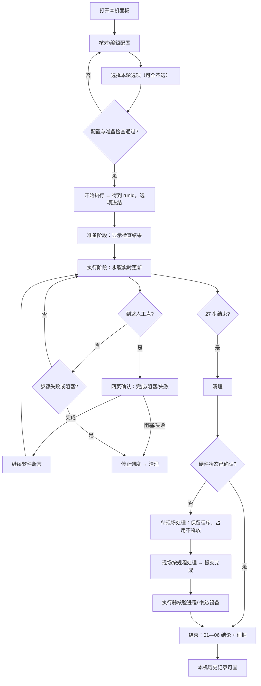

# 需求确认摘要与页面映射（UI 设计基线）

> 本文不新增需求，只把已确认需求转成页面结构与交互约束。需求来源：任务 JCRJZDH-6 正文（WAOI-MAINFLOW-WEB）及附件《主流程自动化回归_Web独立运行_调研与需求.md》。8 项范围与交互选择已由用户确认，本次不再询问，也未扩大范围。
> 27 步编号与名称采用司小懿开工前置核对（对照 `MainFlowStepPlan.cs`）的核对结果；最终仍以卫青 T01 能力表与 `docs\api\openapi.yaml` 为准。

## 1. 产品与平台

| 项 | 结论 |
| --- | --- |
| 产品 | 主流程自动化回归的独立工具，附带本机 Web 执行面板 |
| 用户 | 测试机现场操作员/自动化开发者（单人值守，同一时刻一轮） |
| 平台 | 桌面浏览器访问本机回环地址（127.0.0.1），不做移动端；执行器仍在 Windows 交互桌面 |
| 本期范围 | 01—06 节 27 步；配置编辑、三个运行选项、实时步骤、人工确认、日志证据、刷新恢复、本机历史 |
| 明确不做 | 07—25 节 157 步、多机/云端/账号体系、暂停/急停/跳步、任意重试/断点续跑、持续视频、远程访问 |
| 环境前提 | 管理员权限、可交互桌面会话、无同名被测进程、被测软件已部署 |

## 2. 页面清单（单页应用，三个视图）

| 视图 | 目的 | 对应需求 |
| --- | --- | --- |
| A. 当前运行（默认） | 配置核对 → 选项 → 启动 → 实时步骤 → 网页确认 → 结论/证据 | WEB-01/02/03/04/05/06/07/08/09/10 |
| B. 本机历史列表 | 多轮记录查询，只读 | WEB-12 |
| C. 历史详情 | 单轮步骤、原因、配置快照、日志与证据 | WEB-12 |

单页布局：顶栏（标题/范围徽标/占用/连接/历史入口）+ 左栏（配置、选项、开始、准备检查、本轮快照）+ 中栏（阶段、汇总、确认卡、待现场处理、27 步、结论）+ 右栏（选中步骤的说明/断言/日志/证据 + 状态图例）。

## 3. 需求 → UI 映射

| 需求 | UI 落点 | 关键界面规则 |
| --- | --- | --- |
| WEB-01 配置与前置检查 | 左栏“运行配置”+“准备检查” | 版本/日期在未勾选跳过时必填；勾选后必填星号消失且不阻止启动；密码只显示“已配置”；准备检查不计作步骤通过 |
| WEB-02 单次启动与互斥 | “开始执行”+ 顶栏占用徽标 | 点击后立即出现 runId 与清单；重复提交返回同一 runId；忙/待现场处理时按钮禁用并写明原因 |
| WEB-03 步骤与实时 | 中栏 27 步清单 + 阶段步进 | 步骤开始前先“执行中”；结束发布终态；01.02 允许晚于 02.01 出现；不靠刷新/日志猜状态 |
| WEB-04 四类结果 | 状态徽标 + 计数 + 结论 | 跳过/阻塞必带原因；失败/阻塞立即停止，后续保持未执行；范围文案常驻 |
| WEB-05 人工确认 | 中栏确认卡 | 编号、说明、等待起点/时长、备注、完成/阻塞/失败；无强制通过；幂等与过期拒绝 |
| WEB-06 日志与证据 | 右栏详情 | 失败保留原始原因；证据经产物接口；缺失有明确状态；不含密码 |
| WEB-07 刷新恢复 | 顶栏连接状态 + 提示条 + 快照恢复 | 断线≠失败；按 runId+sequence 去重补齐；刷新不重跑、不新起进程 |
| WEB-08 清理与现场处理 | 阶段步进 + 待现场处理卡 + 结论清理行 | 步骤结论与清理分开；硬件未确认保留程序、占用不释放；现场处理需执行器核验三项 |
| WEB-09 结论 | 汇总计数 + 本轮结论卡 + 报告弹层 | 不显示“184 步全流程通过”；清理失败不显示全部成功；统计每步只计一次 |
| WEB-10 运行选项 | 左栏三复选 + 策略条 + 本轮快照 | 默认全不选；硬件互斥且可都不选；运行中只读；服务端双选错误可见 |
| WEB-11 严格执行能力 | 步骤清单中的“原用例人工点/含硬件部分”标签与执行分支 | 界面不把“人工确认”伪装成自动；严格模式下不出现额外人工替代点 |
| WEB-12 历史查询 | B/C 视图 | 只读；无旧确认按钮；配置快照与证据按 runId 关联；证据缺失不改写结论 |

## 4. 27 步清单（对齐 `MainFlowStepPlan.cs` 核对结果）

| 章节 | 步骤 | 名称 | 硬件属性 | 页面要点 |
| --- | --- | --- | --- | --- |
| 01 启动 | 01.01 | 启动并检查单实例及硬件状态登录窗口 | 部分 | 进程归属 + 单实例 + 硬件状态 |
| | 01.02 | 登录后核对软件版本和编译日期并截图 | 否 | **登录后执行**；可被“跳过版本断言”置为跳过 |
| 02 登录 | 02.01 | 选择 admin 并登录 | 否 | 凭据只显示已配置 |
| | 02.02 | 处理启动初始化及回零提示 | 整步 | 条件判断，不盲目确认 |
| 03 放片 | 03.01 | 放片及工位空片检查 | 原用例人工点 | 网页确认；记录本轮开始时间 |
| | 03.02 | 任务晶圆分布页选择 Loadport1 | 部分 | 槽位与实物一致性 |
| 04 新建配方 A | 04.01 | 打开新建配方窗口 | 部分 | 平台无片/吸附提示条件处理 |
| | 04.02 | 文件类型选配方文件并回读 | 否 | 失焦提交 + 回读 |
| | 04.03 | 输入带秒级时间戳的配方名称并回读 | 否 | **失败分支演示锚点**；禁止覆盖既有名称 |
| | 04.04 | 创建位置选根目录并回读 | 否 | |
| | 04.05 | 选择常规建档模式并回读 | 否 | |
| | 04.06 | 选择 300 和 Notch 并回读 | 否 | |
| | 04.07 | 确定新建并检查配方树、当前配方及落盘 | 否 | 三项断言 |
| 05 晶圆信息 | 05.01 | 打开晶圆信息页并选择正面 2D 检测 | 否 | |
| | 05.02 | 输入产品 ID 和工序 ID 并回读 | 否 | |
| | 05.03 | 取消仿真模式 | 否 | |
| | 05.04 | 选择注水和清洗次数 1 | 否 | |
| | 05.05 | 输入注水冲洗时间并回读 | 否 | |
| | 05.06 | 输入注水后吸水时间并回读 | 否 | |
| | 05.07 | 输入吸附晶圆后的吸水时间并回读 | 否 | |
| | 05.08 | 输入吸附晶圆的真空时间并回读 | 否 | |
| | 05.09 | 处理风刀字段并保存配方 A | 否 | |
| 06 建档上片 | 06.01 | 任务晶圆分布页选择 Loadport1 层 1 | 整步 | |
| | 06.02 | 选择关闭读码和对准角 0 | 否 | |
| | 06.03 | 确认一键上片按钮 | 整步 | 人工策略下现场执行后网页确认 |
| | 06.04 | 等待上片完成并核对平台及来源槽位 | 整步 | **待现场处理分支演示锚点** |
| | 06.05 | 点击配方确认当前配方仍为 A | 否 | |

合计 27 步；页面永远显示 `27 / 184`，157 步标注“未实现”，不计入跳过。
硬件属性分布：整步硬件 4（02.02、06.01、06.03、06.04）+ 原用例人工点 1（03.01）+ 混合 3（01.01、03.02、04.01）= 8 步涉及硬件；纯软件 19 步。

## 5. 选项 → 页面表现矩阵

| 跳过版本断言 | 硬件策略 | 页面策略条 | 01.02 | 硬件步骤 | 混合步骤 |
| --- | --- | --- | --- | --- | --- |
| 否 | 严格（两项都不选） | 严格执行 | 严格断言 | 自动执行 + 断言 | 自动执行 + 断言 |
| 是 | 严格 | 跳过版本断言 | **跳过·明确要求**，原因固定为“本轮选择跳过版本断言（版本号及编译日期）” | 自动执行 + 断言 | 自动执行 + 断言 |
| 否 | 跳过硬件 | 跳过硬件步骤 | 严格断言 | **跳过·整步硬件** | **跳过·部分硬件**（软件断言通过） |
| 是 | 跳过硬件 | 组合 | 跳过 | 跳过·整步硬件 | 跳过·部分硬件 |
| 否 | 人工执行硬件 | 人工执行硬件步骤 | 严格断言 | **等待人工确认 → 成功·人工确认** | 等待人工确认 → 成功·人工确认 |
| 是 | 人工执行硬件 | 组合 | 跳过 | 等待人工确认 → 成功·人工确认 | 等待人工确认 → 成功·人工确认 |

跳过硬件导致后续软件断言前提不成立时显示“阻塞”，不得编造硬件完成。
按 27 步清单，跳过硬件时 8 步记为跳过、19 步成功；人工策略时 8 步需网页确认（含 03.01）。

## 6. 用户流程

## 7. 页面对“事实”的表述纪律

1. 只有 `01—06 执行完成`，没有“全流程通过”。
2. 人工确认写“成功·人工确认”，不写“成功”。
3. 跳过写三类之一并带原因，不写“通过”。
4. 清理失败/待现场处理时，结论区不出现“全部成功”。
5. 演示数据、mock 事件、截图占位必须在界面上可辨识，不能当作实机结果。

## 8. 待对齐事项（草案，不由 UI 设计决定）

1. 27 步名称与章节归属的最终版本（本设计采用司小懿对照 `MainFlowStepPlan.cs` 的核对结果，仍以卫青 T01 能力表与 `openapi.yaml` 为准）。
2. `hardwarePolicy` 枚举命名与严格语义映射（见 `components.md` 第 16 节）。
3. 事件 `type` 完整列表，特别是“待现场处理 / 现场处理确认 / 占用解除”三类。
4. 快照 `counts` 是否已排除 `waiting` / `unknown`。
5. 人工确认超时时长沿用现有配置的具体值（页面只显示等待中，不做前端计时判定）。
