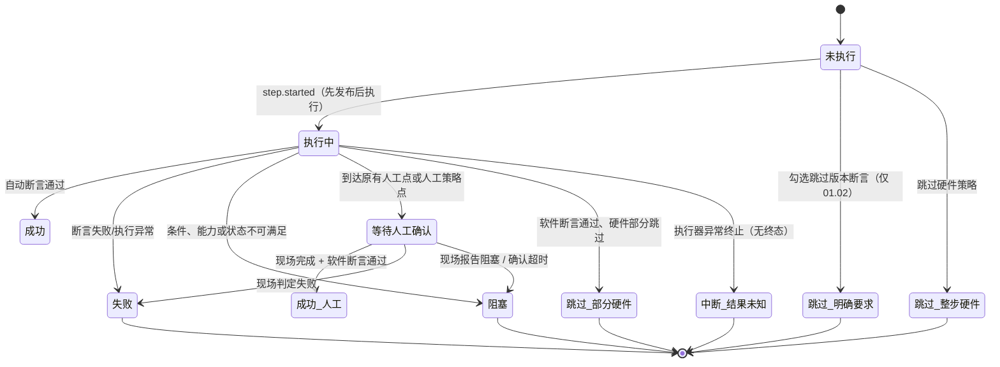

# 低保真线框图与页面流程（27 步本机执行面板）

> 用途：评审布局与信息层级，不涉及视觉细节。高保真实现见 `prototype.html`。
> 视口基准：1440×900 与 1920×1080；标注尺寸为 CSS px。

## 1. 首次进入（未运行）

```
┌──────────────────────────────────────────────────────────────────────────────────────────┐
│ ◆ 主流程自动化回归   [本期 01—06 节 · 27 / 184 步]        [本机空闲] [通道正常] [历史运行] │ 56
├──────────────────────────────────────────────────────────────────────────────────────────┤
│ ┌── 运行配置 ────────────────────┐ ┌ 阶段  ①准备 ─ ②执行 ─ ③等待人工 ─ ④清理 ─ ⑤结束 ┐ │
│ │ EXE 路径*  [D:\...\WaferAOI.exe]│ │                                                     │ │
│ │ 配方目录   [D:\...\Recipes     ]│ │  0 / 27 已收敛步骤（分母为本期 27 步）              │ │
│ │ 证据目录   [D:\...\runs        ]│ │  ▱▱▱▱▱▱▱▱▱▱▱▱▱▱▱▱▱▱  0%                          │ │
│ │ 版本号*    [V3.2.1.7] 日期*[..]│ │ ┌成功 0┐┌跳过 0┐┌阻塞 0┐┌失败 0┐┌未执行 27┐        │ │
│ │ 🔒 凭据：已配置（不回显）       │ │ ⓘ 本期 27 步；完整设计 184 步，其余 157 步未实现    │ │
│ │ [保存配置] [重新检查]           │ └─────────────────────────────────────────────────────┘ │
│ └────────────────────────────────┘ ┌── 步骤清单（章节 01）────────── 0/2 ─────────────┐ │
│ ┌── 本轮运行选项 ────────────────┐ │ 01.01 启动并检查单实例及硬件状态登录窗口 [未执行] — │ │
│ │ ☐ 跳过版本断言                 │ │ 01.02 登录后核对软件版本和编译日期 [登录后执行]     │ │
│ │   01.02 记为跳过…              │ │        [未执行] —                                  │ │
│ │ ☐ 跳过硬件步骤                 │ │ 02.01 选择 admin 并登录              [未执行] —    │ │
│ │ ☐ 人工执行硬件步骤             │ │ 02.02 处理启动初始化及回零提示        [未执行] —    │ │
│ │ ⓘ 两个硬件选项互斥，也可都不选 │ │ … 03 放片 / 04 新建配方 A / 05 晶圆信息 / 06 建档上片 │ │
│ │ ┌严格执行：全部按原步骤执行──┐ │ └─────────────────────────────────────────────────────┘ │
│ │ [        开始执行        ]   │ ┌── 本轮结论 ─────────────────────────────────────────┐ │
│ │ 三项均不选：严格按 27 步执行 │ │ 尚未形成结论。步骤执行中；清理结果与步骤结论分别记录 │ │
│ └────────────────────────────────┘ └─────────────────────────────────────────────────────┘ │
│ ┌── 准备检查 ── 尚未开始 ────────┐ ┌── 步骤详情 ─────────────────────────────────────────┐ │
│ │ · 开始执行后显示本机检查结果   │ │        [图标] 选择左侧步骤查看详情                  │ │
│ └────────────────────────────────┘ │        说明 / 断言 / 日志 / 证据                     │ │
│                                     └─────────────────────────────────────────────────────┘ │
│  360px                              │  minmax(0,1fr)                    │  384px            │
└──────────────────────────────────────────────────────────────────────────────────────────┘
```

要点：

1. 未运行也完整显示 27 步（全部“未执行”），让范围在首屏可见。
2. “开始执行”所在卡片包含策略条，用户不需要记住选项含义。
3. 右栏空态给出下一步动作（选择步骤），不留空白。

## 2. 执行中（含当前步骤与日志）

```
┌ 顶栏 ────────────────────────────────────────────────────────────────────────────────────┐
│ ◆ 主流程自动化回归   [27/184]              [本机占用·执行中] [通道正常] [历史运行]        │
├──────────────────────────────────────────────────────────────────────────────────────────┤
│ 左：配置只读 + 选项冻结 + 本轮快照 │ 中：阶段②执行 + 计数 + 清单            │ 右：详情      │
│ 配置 [运行中只读（本轮快照）]      │ 14 / 27  ▰▰▰▰▰▰▰▰▱▱▱▱ 52%              │ 04.02 文件类型│
│ 选项 [本轮已冻结]                  │ 成功 13 跳过 1 阻塞 0 失败 0 未执行 13   │ 选配方文件回读│
│ 快照 runId run-20261023-…          │ ┌ 01 ───────────────────── 5/5 ──────┐ │ [执行中]      │
│      选项 严格 · 硬件严格          │ │ 01.01 …                    [成功] 4.1s│ │ 说明…         │
│      开始 10:42:07                 │ │ 01.02 … 跳过版本…          [跳过] 0.2s│ │ 断言 ✓ ✓      │
│ 准备检查 ✓ 权限 ✓ 无冲突进程 …     │ │ …                                   │ │ 日志 ▸ 6 条   │
│                                    │ └────────────────────────────────────┘ │ 证据 2        │
│                                    │ ┌ 04 ───────────────────── 2/5 ──────┐ │ [截图][树]    │
│                                    │ │ 04.01 …                    [成功] 4.0s│ │              │
│                                    │ │▌04.02 配方参数录入与校验  [执行中] 2.6s│ │              │
│                                    │ │ 04.03 …                    [未执行] — │ │              │
│                                    │ └────────────────────────────────────┘ │              │
└──────────────────────────────────────────────────────────────────────────────────────────┘
```

- 当前行：左侧 3px 蓝条 + 浅蓝底 + 旋转图标；耗时每秒刷新。
- 章节头吸顶，显示 `完成/总数`，滚动时保留“我在哪一节”。
- 顶部计数与进度条是唯一汇总来源；右栏不重复统计。

## 3. 等待网页人工确认（WEB-05）

```
│ ┌─ 等待现场操作确认  03.01  [原用例人工点]              [◌ 等待人工确认] ─────────────┐ │
│ │ 步骤 放片及工位空片检查            等待起点 10:51:33                             │ │
│ │ 已等待 00:01:24                    确认点 ID cp-0301-a7f2                        │ │
│ │ ┌ 现场操作说明 ────────────────────────────────────────────────────────────────┐ │ │
│ │ │ 1. 按原用例要求完成现场放片并检查工位空片                                     │ │ │
│ │ │ 2. 检查槽位与实物一致后在下方填写备注                                         │ │ │
│ │ │ 3. “完成”仅表示现场已操作，软件断言仍会继续执行                               │ │ │
│ │ └──────────────────────────────────────────────────────────────────────────────┘ │ │
│ │ 备注 [                                              ]  （阻塞/失败时必填）        │ │
│ │                                   [判定失败] [报告阻塞] [完成（现场已操作）]      │ │
│ │ 刷新或重连会恢复本确认点，计时不重置；旧页面/已结束确认点提交将被拒绝。            │ │
│ └──────────────────────────────────────────────────────────────────────────────────┘ │
│ （清单与右栏日志保持可滚动、可查看；不使用模态遮罩）                                  │
```

- 确认卡在清单**上方**，占满中栏，但不清空已可见步骤。
- 三个按钮同一行，危险操作在左，主操作在右，避免误触。
- 等待期间该步骤状态为“等待人工确认”，不是“阻塞”。

## 4. 失败停止 + 清理

```
│ 阶段  ①准备✓ ─ ②执行● ─ ③等待 ─ ④清理◌ ─ ⑤结束        [本机占用·执行中]              │
│ 成功 14  跳过 1  阻塞 0  失败 1  未执行 11                                              │
│ ▌04.03 输入带秒级时间戳的配方名称并回读        [失败]  2.4s                            │
│   断言失败：配方名称回读不一致（界面值与输入值不同）                                │
│ 04.04 … [未执行]   04.05 … [未执行]   （其余章节保持未执行，不批量改跳过/成功）          │
│ ┌ 本轮结论 ─────────────────────────────────────────────────────────────────────────┐ │
│ │ ! 本轮未通过：04.03 配方名称回读失败                                                    │ │
│ │   已在失败步骤立即停止；后续步骤保持未执行，随后进入清理阶段。                      │ │
│ │   清理状态：清理完成：本轮进程已退出，无冲突进程，占用已释放                        │ │
│ └────────────────────────────────────────────────────────────────────────────────────┘ │
```

## 5. 待现场处理（WEB-08）

```
│ ┌─ 待现场处理                                        [本机占用未释放] ───────────────┐ │
│ │ ⚠ 硬件状态未确认：本轮不自动关闭被测程序，不因超时或确认失败继续原清理逻辑。        │ │
│ │    未完成现场处理前禁止新一轮；页面不提供“强制解锁并继续”。                        │ │
│ │ runId run-…-27ab        阻塞步骤 06.04 等待上片完成并核对平台及来源槽位                   │ │
│ │ 原始结论 阻塞（不因现场处理改为成功）   被测进程 WaferAOI.exe · PID 18472（保留中）  │ │
│ │ 现场处理规程 1) 安全处理设备 2) 按规程退出/保留程序 3) 确认无冲突进程 4) 提交        │ │
│ │ ○ 被测进程已退出（PID 18472）        ○ 无冲突被测进程        ○ 设备状态已明确确认    │ │
│ │ 现场处理记录 [                                                    ]                │ │
│ │                              [重新核验现场状态] [提交现场处理完成（核验前禁用）]     │ │
│ └────────────────────────────────────────────────────────────────────────────────────┘ │
│ 步骤清单（只读展示，不再出现确认按钮）                                                 │
```

## 6. 连接中断 / 恢复

```
│ [◌ 状态通道中断]  ──────────────────────────────────────────────────────────────────────│
│ ⚠ 状态连接中断：执行器可能仍在运行；连接失败不等于测试失败，页面正按 runId 重连。        │
│   已显示状态保持不动，不清空、不重跑。                                                  │
│ …重连后：                                                            [toast] 快照已恢复，│
│ ◌ 正在补齐事件…  →  ● 状态通道正常                                补 12 条事件，未重复  │
```

## 7. 本机历史（WEB-12）

```
│ ┌── 本机历史运行 ──────────────────────────────── 3 轮 · 只读 ──────────────────────┐ │
│ │ ⓘ 历史记录来自本机证据目录，重启后仍可查询；修改当前配置不覆盖历史快照。            │ │
│ │ runId                    开始时间          执行策略            结论    清理   计数  │ │
│ │ run-…-9f3a               2026-10-23 10:15  版本严格·硬件严格  [通过]  [已清理] …   │ │
│ │ run-…-11c7               2026-10-23 09:30  版本跳过·人工硬件  [通过]  [已清理] …   │ │
│ │ run-…-27ab               2026-10-22 17:45  版本严格·硬件严格  [待现场][待处理] …   │ │
│ └────────────────────────────────────────────────────────────────────────────────────┘ │
│ 详情页顶部固定：历史记录 · 只读  runId …（无确认/执行按钮）                             │
```

## 8. 状态机（步骤生命周期）



规则：失败/阻塞/中断后不再进入“执行中”；页面不提供任何把终态改回成功或跳过的入口。
